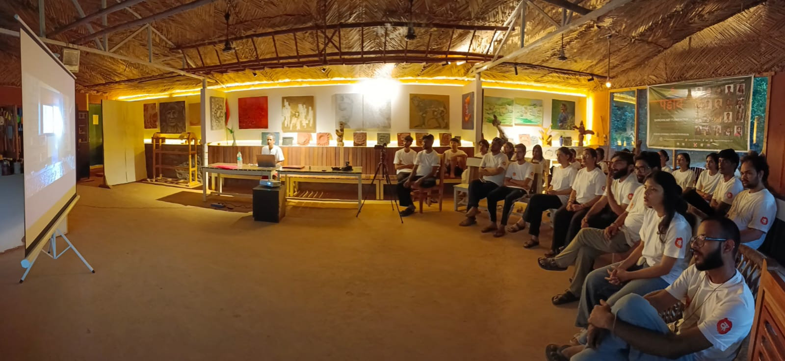

There is a particular kind of learning that happens not in a classroom but in a shared space — when artists from different valleys sit together, show each other their work, and begin to find the threads that connect them. That is what Padav has always tried to make room for. This year, it did so again.

The fourth cohort of the Padav Art Mentoring Program brought twenty young artists to Kaaya Learning Centre in Tilwari village, Dehradun, for six residential days in early 2026. They came from across the Himalayan region — different languages, different altitudes, different relationships to the land. And yet, when they began to speak about their work, the same concerns surfaced again and again: the mountains, the rivers, migration, folk memory, the slow shifting of social life in hill communities.

Art, it turns out, is one way the mountains speak to themselves.

**Mentorship as Conversation**

The core of Padav is not the programme — it is the individual conversation. Each participant received dedicated one-on-one time with senior mentors who sat with their work, their doubts, and their questions about the road ahead. There were no generic prescriptions. The aim was to meet each young artist where they were — to help them see their own practice more clearly, and to think honestly about where it might go.

Kaaya's own founding intent shaped the atmosphere of the week: that the most meaningful learning happens through dialogue, through the friction and warmth of exchanging real experiences. That belief was tested and confirmed across six days.

**A Week of Many Voices**

The programme wove together craft, context, and community in equal measure.

It began with the hands and the body — with the unglamorous, essential groundwork of preparing and stretching canvases, and with theatre-based activities that helped twenty strangers become, by the end of the week, something closer to collaborators. Before anyone spoke about art, they learned to be in a room together.

Then came a week of widening circles. A curator and researcher opened up the architecture of the contemporary art world — how institutions think, how curation works, which doors exist and how they open. A painter with two decades of sustained practice spoke about the long game: what it takes to remain faithful to a vision through years of quiet work, through periods of doubt, through the gap between making and being seen.

An artist whose practice spans painting, sculpture, film, and video — rooted in folk memory, in classical music, in the textures of rural and urban India — showed what it looks like when a body of work builds slowly into something with real weight and coherence. A visual storyteller working across design, cinema, and documentary practice spoke about the power of how artistic journeys are documented and shared — that the work of bearing witness to creativity is itself a creative act. And a practitioner fluent in the art market spoke plainly about the practical terrain: pricing, presentation, how to communicate your work to people outside your immediate circle.

A documentary film on a significant but under-celebrated figure in Indian modern art gave the group a different kind of input — not instruction, but immersion. The texture of a life spent making work on your own terms.

One of the mentors closed the week by tracing his own journey — from a remote Himalayan village to decades of practice that carried him far from home and back again. The insight he offered was quiet but lasting: what shapes an artist's voice is not distance from where they come from, but a deepening relationship with it. With memory. With language. With the spiritual atmosphere of a particular place.

**What Stays**

By the final day, it was clear that Padav had done what it set out to do — not transform anyone, but give them a clearer sense of themselves. The artists left with new friendships, widened perspectives, and in many cases a more settled feeling about the direction of their independent practice.

The Himalayan region has long produced artists who work largely in isolation, separated by distance and by the relative scarcity of platforms that speak to their specific context. Padav is quietly building something to address that — a network, a continuity, a shared vocabulary for artists who share a landscape even when they have never met.

We are glad Kaaya could be part of it this year.

> The Padav Art Mentoring Program is a joint initiative of Kaaya & Bangani Art Foundation, now in its fourth year.

For more about Kaaya' as a space to incubate ideas & programs, visit the Incubate section of our website.
