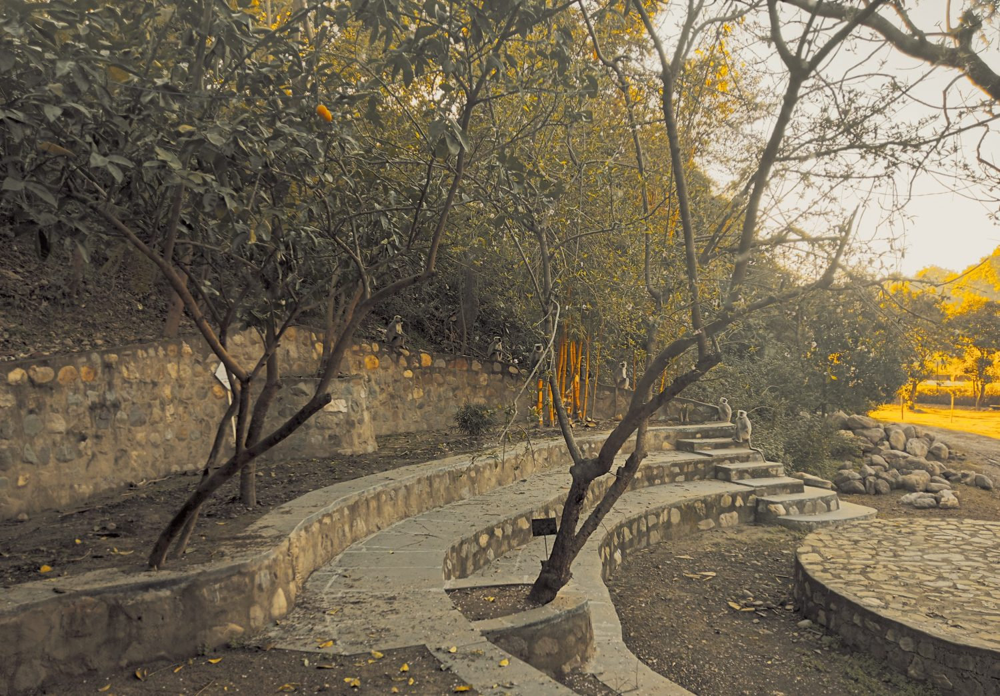

## This note is part of the series on climate change and sustainable living initiated by Kaaya.

Kaaya Learning Centre is a place where we learn to adapt and apply our knowledge in different situations. Kaaya has a physical site and a market-based way of covering its expenses, which makes it part of the hospitality sector. People come to Kaaya for the experience it offers.

Over time we have found that Kaaya suits guests who come to slow down and be with nature, and we try to welcome them. Some visitors want to be close to nature without quite meeting it, and the place seems to suit them less.

When women took responsibility for managing Kaaya, we noticed that guests' behaviour changed. With women handling the bookings, the front desk and the service, the place seems to have gained a natural filter. It quietly discourages some kinds of guests and welcomes others: families, solo travellers, and groups of young women looking for a retreat.

So what has changed, and why does it matter?

Have you noticed how your own behaviour changes in feminine spaces? Such spaces tend to hold values like nurturing, cooperation, empathy and creativity. Many of us notice that we feel calmer in them, trust more easily and talk more openly, whether we are men or women.

In these spaces our behaviour adapts to the norms and expectations around us. We mirror the emotions, attitudes and actions of others, to fit in and to avoid conflict.

Tourism is perhaps where this shows most clearly. It runs on human interactions and experiences, yet it is mostly owned and run by men, though women make up over half its workforce. Interestingly, it is often the woman who decides where a family will travel, and she is often the one looking for meaningful experiences that connect the family with local culture and people.

The challenge is to find a form of sustainable tourism that needs less building and puts more emphasis on living with nature. Homestays are popular in Uttarakhand and in other mountain regions, and in them women usually take care of everything. Women are often seen as nurturing, which may help them care for nature's diversity and appreciate how everything depends on everything else.

But if women also begin to make the decisions in homestays, will that change how we behave as tourists? Could it help protect the mountains from overdevelopment?

The recent tragedies in the mountains during the rains point to how we are developing them. The pressure to add more rooms, use up every bit of space or carve out more is constant, and owners make such decisions on site every day. Are they simply responding to what the tourism sector demands, or can they choose differently? These everyday decisions add up, and in the mountains they can matter a great deal.

Women-centred spaces and homestays in natural places offer authenticity and connection. Run by women, such spaces may shift how tourists behave while helping preserve the environment. Staying with a local family lets travellers experience other ways of living, and can change how they think about tourism itself. Over time that may influence the demand that drives unsustainable tourism.

Women-owned or women-managed spaces are not without challenges, such as safety, privacy, quality and cultural friction. Even so, they may offer a more sustainable path given climate change, the limited carrying capacity of the mountains, and the need for tourism to grow in a better way. We are still learning what this means at Kaaya.

