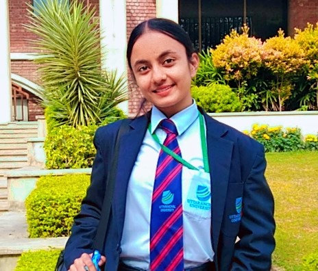
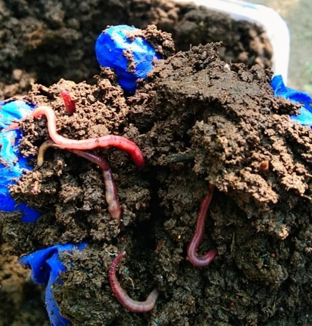
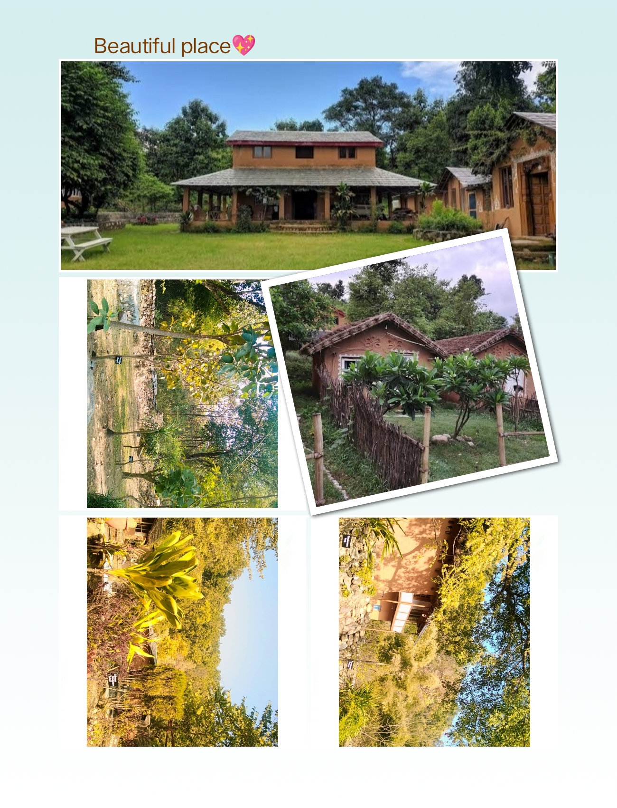
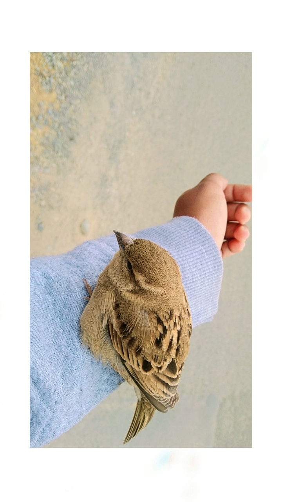

Shagun Manwal

BSc Life Sciences, 2nd Year, Uttaranchal University, Dehradun

## My fine-tuned Internship experienceat KaayaLearning centre

It’s been almost two weeks away from my home since I had started my internship at Kaaya with the onset of this year. I had never thought I’ll be able to learn this much in just two weeks. In these two weeks I had completed my three tasks which had been assigned to me on the first day of my internship. These include plant identification and labelling, vermicompositing and apiculture, soil testing etc. with their outputs.

Out of which my keen interest was in learning vermicompositing and apiculture.

## Why I thought of learning these-

It was last month of 2023, when I had thought of doing internship in my upcoming winter breaks, in my field of interest. As a life sciences student, vermicompositing and apiculture could be the best option.

Though, since my childhood I had a great fear of creeping crawlies but still I decided to go with these two so as to learn new things and to get rid of my fear.

## Now, what happened next? How I landed to this place?

I remembered the time when I had for the first time visited Kaya and that too when I was small. So I realized, during that time various bee boxes were also placed there. To confirm I just asked my maternal aunt whether the place nearby you provide internship to students or not? And by god’s grace it did. So I just asked for their contact details and thus contacted them to confirm. When they asked us to visit the place once to get de-brief regarding it, without wasting a couple of days I with my friends had visited the place as soon as our exams got over. As we reached the place we were very pleased with the environment out there. It was descent and beautiful.

## Nature + Animal friendly Environment of Kaya

Kaya provides a very descent and peaceful, nature friendly environment to interact with the living creatures. Variety of trees here, are a home to various birds and insects. Honey bees buzz around and birds chirp and build their nests freely. This is due to peace and simplicity of the place. The place adopts a very beautiful ethic of celebrating things without creating noise by not allowing loud music to disturb the living beings (not humans). Even the decoration out there is nature friendly replacing polluting rubber balloons by the paper crafts. Few lights out their do not disturb the sleep of animals and birds at night. Trees are planted according to the amount of shade or sunlight needed along a particular direction. It includes various varieties of spices, medicinal plants, trees etc. Birds feel free to build their nests on these trees. Therefore Kaya is best suited for all those people who love such kind of environment.Birds feel free to build their nests on these trees. Therefore Kaya is best suited for all those people who love such kind of environment.

## My Vermicompositing Experience

Vermicompositing was very new to me. I had just read about it in my books till now but experiencing it was even more exciting.

After researching about it, we begin by setting a small plastic pit at the backyard in the greenhouse area but the biggest task for me is to collect raw materials for the process. First I need to find 30 kg of fresh cow dung. Such a huge amount nearly close to my weight was easy to get as it was village area and my relatives too have cows at their place but to carry it was not an easy task. Though the team of kaya was very supportive that they somehow carried that 30kg dung in a plastic sac to kaya. With this on the particular day only, we had filtered the soil and had set the bottom layer of it (of about 2-3 inches) in the compost pit spoiling all my clothes. After that we spread the second layer which was of 30 kg cow dung to make vermibed over it unknowingly that I need to spread it with my bare hands. Moistening and spreading it evenly with my bare hands and side by side making its documentation with the same dirty hands was an unimaginable feeling but it was quite fine. After this another challenging task for me was to find worms and that too special quality red worms (Lumbricus rubellus) which was not easy to get in this area. So we had visited an agricultural organisation on the next day to get them. And to my surprise I was asked to pick those worms from my bare hands out there, though my mentor had asked me to do the same and get a photograph clicked with them but I never thought of doing it without having gloves on. It was a very awful experience. After getting those worms as soon as we reached Kaya I this time firstly putting gloves on my hands dug the holes in vermibed putting those worms into it. Thus finishing the most difficult part of the process. Now again after making the layer even I spread another layer of cow dung over it moistening and levelling the same. Lastly I just need to spread the biodegradable kitchen waste over the compost to finish the process thus waiting for the compost to get ready after three months.
