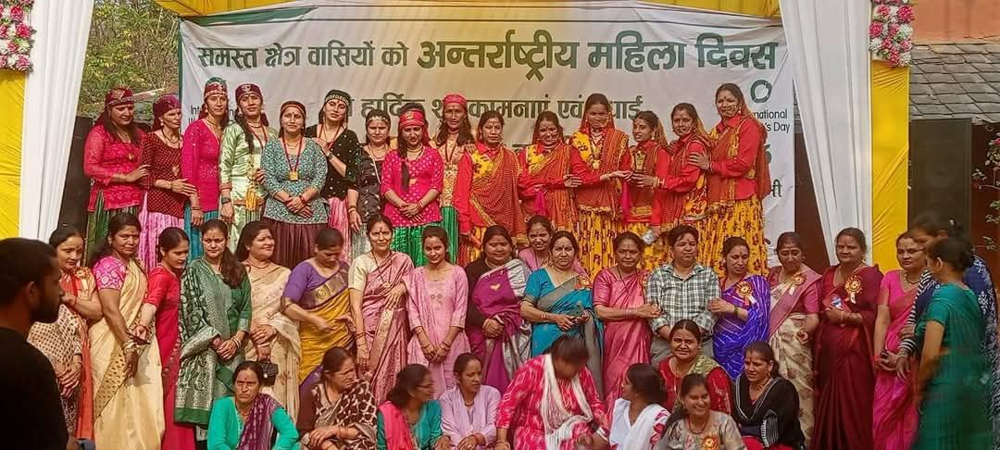

Kaaya runs on exchanges that go both ways. Money is one of them, but so are food, knowledge, care, attention and trust. Looking back, we came to see that when each party gains something it values, the arrangement keeps itself going.

We share it here in case it is useful to others working in remote places: social change agents, people in government, and other social enterprises. It needs no large funding, only a small enterprise, a willing community and time.

The picture below shows the whole of it. Choose a line or a place to read what moves each way. For a simpler way in, [follow one meal on the model page](/the-model/).

[[value-exchange-diagram]]

## Layer 1: The core

### A small enterprise and a village

**Kaaya to the village:** An independent platform for community events, a market for local vendors and suppliers, wages and salaries for the local team, honorariums for volunteers, and simply a space where the village, especially its women, can come together.

**The village to Kaaya:** Produce from the kitchen gardens, pickles and craft for the Mart, and the cooking and care of the women who run the place.

## Layer 2: Those who come

### Guests and Kaaya

**Guests to Kaaya:** They pay for a meal, a stay or an evening. This keeps the café and the stays going.

**Kaaya to guests:** They find good food, a slower day, and a place where they are treated as family rather than as customers.

### Guests and the village

**Guests to the village:** They buy directly from the community, pay a fair price for its effort, and give the village reason to hope for its future.

**The village to guests:** Guests leave with fresh food, a sense of where it comes from, and stories. Some become part of the Kaaya community and keep coming back, so the relationship continues and grows.

### The village and learners

**The village to learners:** Farmers and community members share what they know of seed, soil, cattle and fieldwork, in the places where they practise it every day.

**Learners to the village:** Farmers receive the attention of visitors who want to learn, and see that their work matters: not just a daily grind, but something of real value.

### Learners and guests

**Learners to guests:** Learners leave their imprint on the campus: art in the gallery, handprints on the walls, stories that linger in conversations and blogs. Guests find a richer tapestry of experience each time they visit.

**Guests to learners:** Guests' interest, support and return visits help keep the campus running, and make it possible to host more fellows and interns.

### Patrons and Kaaya

**Patrons to Kaaya:** People who see the value in the place keep investing in it in everyday ways. They hold birthdays, family gatherings and guest meets here, and dine at the café rather than at a restaurant in the city, though it means a forty-minute drive. They do it because they enjoy it, and because they know Kaaya needs the income.

**Kaaya to patrons:** A place that feels partly their own, and the quiet satisfaction of seeing what they spend become wages, a community kitchen and fellowships.

## Layer 3: The frame

### Government and the village, through Kaaya

**Government to the village:** Through the Setu Aayog smart-village initiative, the ISVC centre at Tilwari brings information, schemes and services closer to people, with a place for children and villagers to meet.

**The village and Kaaya to government:** An anchor already on the ground, trusted by the community, where programmes can take root and be looked after. Looking back, we think this is why Setu Aayog chose to work with us: the relationships were already there.

## How the coin turns

**From Kaaya Offline to the work:** Every meal, stay, ticket and jar sold becomes wages, a kitchen, honorariums, events and fellowships.

**From the work back to Kaaya Offline:** Vegetables from the kitchen garden on the café's plates, village makers' produce and craft in the Mart, and art by Padav fellows on the gallery walls.

## What the earnings make possible

### A team from the village

Salaries for the full-time team from the local community. Wages for women who manage their households and still come in for a few hours. Steady work for local repair and maintenance teams and suppliers as the campus grows.

### A community kitchen

One kitchen that feeds everyone working at Kaaya, including the volunteers and interns who come to support community initiatives.

### The smart-village centre

Honorariums for the two community volunteers who run the ISVC centre at Tilwari, where children and villagers gather for information and meetings. Kaaya also set up the children's library there, run by volunteers.

### Days for the village, and its young people

Women's Day, Independence Day and Children's Day with the women and youth of the village. Internships for local youth, and fellowships such as Padav.

## Coming back, and going deeper

Some guests come back often enough to become part of the place: as members, as patrons, as people who plan events with us.

## Could this work elsewhere?

We don't think Kaaya is a template, but the pattern may travel. A small enterprise that earns its own way, buys and hires locally, and opens its space to the village. Visitors who pay, and are given something real in return. Learners who take knowledge and give back attention. Patrons who choose to spend where it matters. A government that finds a trusted partner on the ground.

None of these is new on its own. What we are re-imagining is how they fit together, and how value can be seen in more forms than money. We are still learning whether it holds, and we would be glad to learn from others trying the same.

## Still learning

Much of what happens here builds on what the village, government programmes and organisations working in these hills had already begun. We are grateful to learn alongside them, and we expect this model to keep changing as we understand more.
