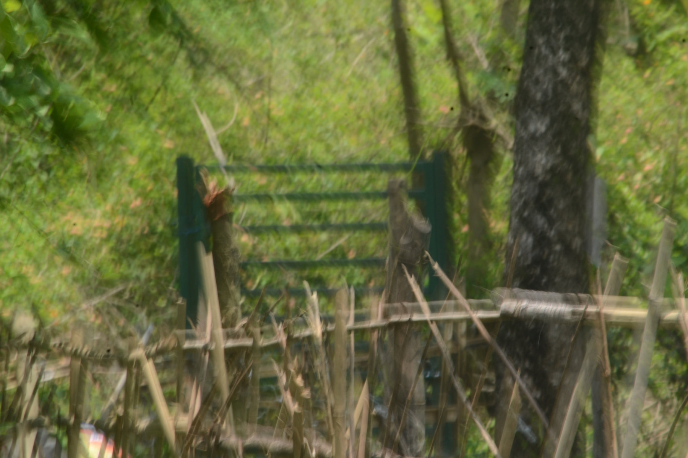

In the larger pursuit of “development and growth”, many of us lose our connection with nature, with ourselves, our families, our communities and our neighbourhoods. We forget that it is our immediate surroundings – the people, their homes, the soil, water, air and trees – that sustain us and nurture life.

*Kaaya grew out of this sense of a growing disconnect from the things that really matter. City life tends to make us consumers, even of our own education. Knowledge and information are now at our fingertips, yet our ability to absorb, reflect and act is being tested. Are we making the right choices, or is the sheer volume of information holding us back from acting, even as the crisis of sustainability grows around us?*

## *The beginning*

It began in 2011, partly out of curiosity about how the rural–urban continuum really works. The idea was simply to stir a little, watch the patterns that emerged, and perhaps re-imagine some possibilities for living sustainably.

*Kaaya began as an experiment. In 2012, a small piece of land was bought in a village far from the city.*

There was no blueprint; we wanted to see how it would evolve. We called the place Kaaya, which means ‘body’: the outer, physical form that a person who visits or lives in a space leaves a little of themselves in. A small mud building went up, made from local material and within the little we had. Slowly people began to visit, often with something they felt was worth doing. Over time it became Kaaya Learning Centre: a place to live, make nature art, build, learn farming, or buy directly from farmers.

As we grew, we couldn’t help noticing that streams were drying up, sloping fields were eroding, and the biodiversity around us was slowly being lost. This weighed on us, and we began to imagine Kaaya as a ‘learning ground’, a place where people take some responsibility for their neighbourhoods. The idea of an eco-school took shape around three words – experience, engage, express – so that we could keep learning, doing and sharing with our hands.

Making this happen day after day took perseverance, will and some resources, but above all it needed people, a steady flow of them, to keep us inspired. More than a decade on, we have not only managed to survive; we feel we may have built something of value for the next generation to use.

## *The approach*

*We went into the village without any project or blueprint in mind. We set out to explore, not to define problems, and to look for what was already working.*

We also chose to manage on our own reserves and to build on what already existed. We tried to think like farmers: diversify, keep risks small, recycle and reuse, save, and find ways to survive and grow sustainably. For us this meant becoming more grounded and creative, and sharing openly what we were trying to do. Intent, trust and honesty, together with programmes built with collaborators, are what began to bring city visitors to Kaaya, some to learn and some simply to stay close to nature.

## *Evolution*

Kaaya brought city visitors and schoolchildren to a village that had nothing to do with tourism. The village became the teacher, showing how it grows food, cares for cattle and lives with nature, and saw the appreciation in the young visitors’ eyes. The village’s own children, many of them hoping to move to the city, wondered why city people were coming to their village.

*Kaaya became a bridge between the rural and the urban. City consumers are becoming more aware of rural life, and their interest in rural products is encouraging village producers and artisans. Some young people are now choosing to stay, or to come back. We are still learning how best to support that energy.*

## *How Kaaya is organised*

Kaaya is run as a social enterprise, so that it can keep doing what it loves. The idea is simple. A registered company manages the campus – the “hardware” – with meals and stays as its income. Everyone who comes pays for meals and accommodation, whether they are families, workshop participants, guests or schoolchildren. A small, committed local team, led by women, runs the stays, the kitchen and community outreach. The company structure sustains this team and keeps us within local laws, while protecting the spirit of the enterprise.

What makes Kaaya what it is, is its programming – the “software”. A small group of us, from the city, design and support the programmes. Sometimes we bring in volunteers or trained people for particular activities, and Kaaya bears the cost when it sees value for the neighbourhood.

*This way of working has given us the freedom to adapt. During Covid, when learning programmes stopped, Kaaya began hosting nature lovers, solitude seekers and people working remotely, and that kept the team going.*

## *Still evolving*

Through modest means, and by earning our own way, we have been able to welcome students from many parts of India, and sometimes from abroad, for practical, hands-on learning.

The villages around us offer far more as a learning ground than we have been able to take up so far. We have made a start: students and volunteers work on ‘live projects’ on local issues, and with the community we have taken our first steps towards community-supported agriculture.

The campus itself is still being built, and we use it as an incubation space to try out ideas for sustainable living. As it has grown, we can now host small groups for events and themed workshops.

*Perhaps it is time to help create an ecosystem where mentors from different fields work together and channel young people’s energy into sustainable ventures. Padav, a mentoring fellowship for young artists, is one step in that direction.*
