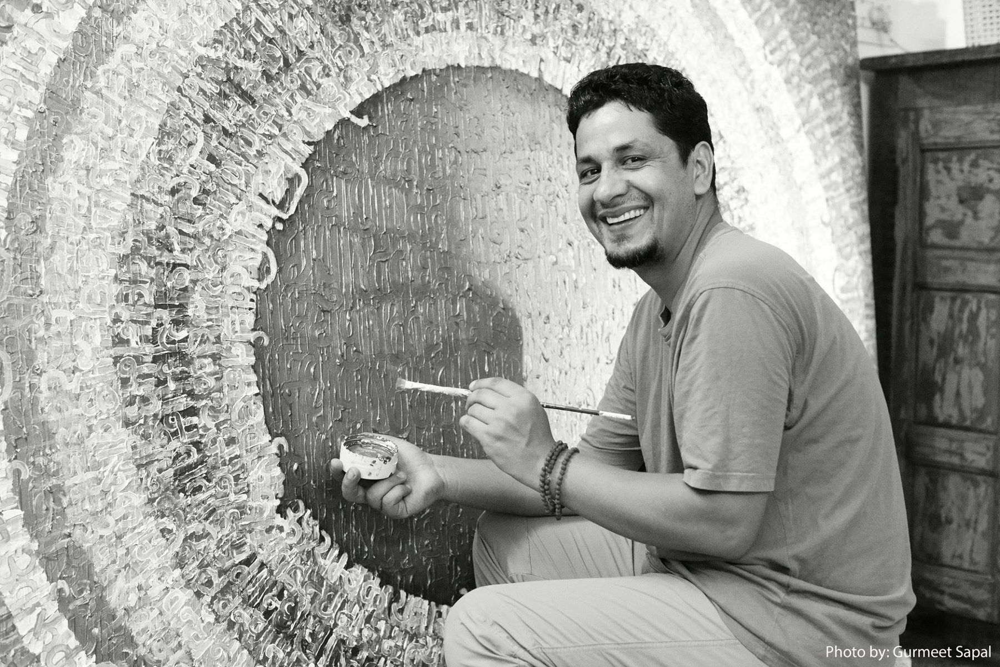
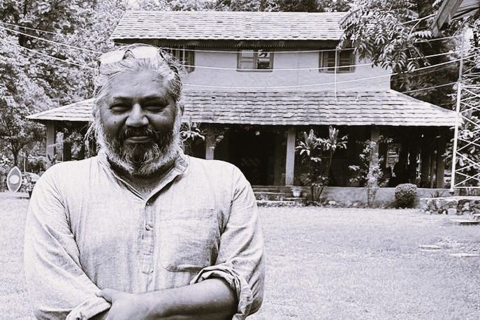

"An Innovative program for such Mentors, who want to show the way to the youth, who have taken initial few steps on their own"

“Padav (-a camp) is a stopover in one’s journey. It is usually a natural place to rest, with water, food, and shade, with people around. It is the space, where there are relaxed conversations without prejudice & expectations, co-travellers sharing insights, exchanging tips, and even getting guided by someone to the way forward, particularly by those who have walked on the same path before.”

kaaya

The "Padav" programme is an opportunity where in Mentor and the Mentees can connect. They live as "residents" in Kaaya for a short period.

In a Departure from conventional Mentor – Mentee relations, this program focuses upon the relevance of ‘space’ as a facilitator to allow experiential sharing to happen.

Kaaya Learning Centre is designed to foster real, experience-based connections in a natural environment. It is a physical setting, in which people live, function, and learn.

Under Padav program, a working relationship is established between Mentor & Mentees that is maintained further via offline as well as online means.

## Program Scope

The programme seeks to provide fellowship to 100 new fellows each year, divided into five cohorts of (12-20) fellows. Each year, we would work with 5 Mentors representing the theme areas listed below.

\1. Arts field/performing arts

\2. Handicrafts and Artisans

These are two areas where Kaaya presently help Mentors by providing an enabling setting and assistance. Kaaya, for example, features a tiny art and pottery studio, a wood workshop, an amphitheatre, and a small nursery.

## Program Components

The Mentor

Someone who made a remarkable journey and arrived at a location from where he or she can look back. When they turn back, they find that there are others who have already begun their journey. They (the mentors) feel that by stopping, meeting, and possibly sharing their own journey, at least some of the young people will be inspired or motivated to advance further.

The Mentees (the fellows)

Mentees in this programme are typically individuals who have exhibited some early dedication to the journey that they embarked upon. The Mentors usually define the eligibility criteria. There is an application call for the programme, and the first shortlisting (between 12-20 fellows will comprise the first cohort) is done at the Mentor/Kaaya level.

The Physical space (Padav I)

The physical site for the first "padav" residency, where the Mentor and Mentee live together for a week, is Kaaya Learning Centre in Dehradun. The space offers logistics as well as a framework for Mentor-Mentee relationships to evolve and deepen. It's often incorporated into the design of their daily routine, activity schedule, hands-on sharing areas, food, and living context.

The Mentor’s space(Padav II)

The physical site for the second "padav", where the Mentor and Mentee connect again for a month. Usually, this will be the studio, home, workshop, or the rented space in the neighbourhood of the Mentor. From each cohort, a few fellows will be selected by the Mentor/Kaaya for Padav -II for this intensive exposure. Here they will get access to not only Mentor’s connection & network but also opportunities to showcase/share their independent work.

## Padav, June 2023: in the fellows' own words

A short film put together by one of the fellows during the mentoring residency at Kaaya, 11–16 June 2023.

https://www.youtube.com/watch?v=cW4RglD-sb0

## Note to sponsors

If you like what we are trying to do under ‘Padav’ program and want to help,

- You can help us reach out to potential Mentors as well as candidates by spreading the word.
- You can support the entire programme or fund specific Mentors/fellows/Mentees.
- You can advise us on ways to expand the scope and reach of this programme and provide additional support. You will be properly recognised.

Contact, for more info  [jbangani@kaaya.org](mailto:jbangani@kaaya.org); [santosh@kaaya.org](mailto:santosh@kaaya.org) ; +91 8279959201

## About the founding members of Padav Program

**Jagmohan Bangani** is a fulltime visual artist from Uttarakhand. Raised up in remote Bangaan region in Uttarakhand, he has travelled far and now lives and works in Delhi. He has a Master degree (Painting) from Winchester School of Art, Winchester, UK. He is a recipient of Ford Foundation Fellowship (New York), Junior Fellowship (Ministry of Culture, Government of India) and a Research Scholarship from Lalit Kala Akademi, New Delhi.

So far, he has done six solo shows including Visual Scriptures (2017), Scriptural Enchantment (2011), Texts, Words & Scripts (2010), Tapestry of Words (2008), Shabd- Nishabd (2007) and Early Memories (2004).  His works are exhibited in a number of major group art exhibitions in India and abroad. His participation of artworks has been with several art fairs, art camps and residencies in India and abroad.

Bangani’s art works are in collection with Secretariat Uttarakhand State (Dehradun), Lalit Kala Academy, the Ford Foundation, Sahitya Kala Parishad, AIFACS and a number of private collections in India and abroad.

S**antosh Passi** is a development practitioner; Sensing a need to actively create a space for an urban-rural connect program, Santosh conceptualized the idea of Kaaya in 2011. He is an alumnus of Indian Institute of Forest Management and a Fellow in International development Policy from Duke University in USA. He is a recipient of Ford Foundation International Fellowship (IFP) and a Scholarship from Ministry of Environment and Forests, Government of India to pursue higher studies.

Primarily, he worked in the community development sector as a program & policy evaluation consultant. In 2011, he decided to create Kaaya as a social experiment. Since then, he is giving his full time to Kaaya’s evolution that has taken shape as a social enterprise around which innovative programming can be done. Kaaya essentially brings one closer to sustainable living practices.
