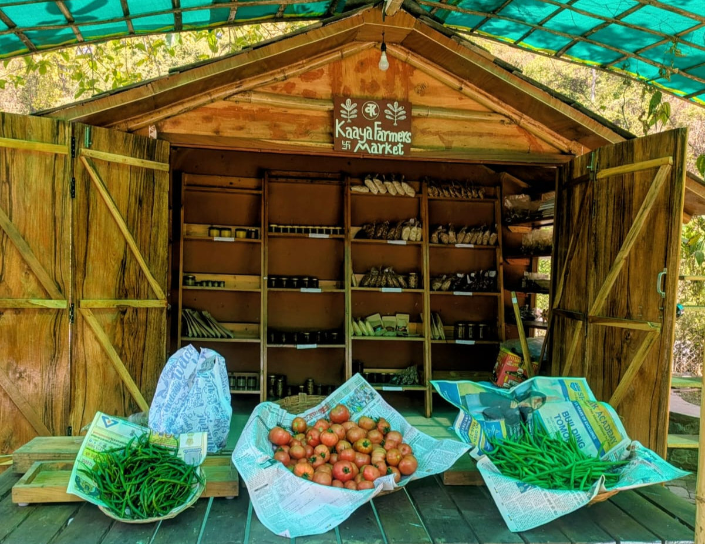

**An upcoming initiative at Kaaya Learning Centre**

*There is a quiet problem that most villages live with and rarely name. Every week, money leaves. A household walks to the town market, buys tomatoes, dal, dairy, a packet of seeds — and the cash that could have stayed in the neighbourhood disappears into a distant supply chain. The village grows food, but somehow still pays an outsider for it.*

*At Kaaya, we've been sitting with this question for a while. And this year, we're ready to try something about it.*

*The Sunday Farmer's Market*

*Starting soon, we'll be hosting a weekly Farmer's Market every Sunday — a simple, open platform where local farmers and kitchen gardeners can bring their surplus produce and sell it directly to their neighbours.*

*No middlemen. No transport markups. No long chains between grower and table.*

*The pricing will match standard retail rates from external markets — so if tomatoes are going for ₹60 per kg in town, that's exactly what they'll cost here too. Buyers pay no more than they would elsewhere. But the money stays in the village, and growers keep a far larger share of it than any conventional supply chain would allow.*

*This isn't a boutique farmer's market for urban weekenders. It's a neighbourhood economy — villagers growing for villagers.*

*What Happens to Unsold Produce?*

*Perishables are a real concern, and we're not ignoring that. Kaaya will actively support the community in processing excess produce — through solar dehydration, pickling, and packaging — so that no harvest is wasted and revenue streams remain stable even when immediate demand dips.*

*Understanding Where the Money Goes*

*The market is the first step. But to build a genuine circular economy — one where wealth circulates locally rather than leaking out — we need to understand exactly what our community currently buys from outside, and whether any of it could realistically be made here instead.*

*This is why we're sending a student intern research team into the neighbourhood over the coming weeks. Their task: a detailed household consumption survey that maps exactly how much capital leaves the village, on what, and how often.*

*They'll be looking at fresh vegetables, specialty foods, dairy, packaging materials used by small local enterprises, and more. The findings will help Kaaya's planning team answer some hard questions — should we focus tightly on food substitution first, or expand quickly into dairy, bakery, composting, and seed production? The data from real households will guide that decision.*

*Why This Matters*

*The principle behind all of this is straightforward: what a community produces, it should also be able to consume — locally, fairly, and without sending its wealth away.*

*The Sunday market is one step toward that. The household survey is anoth*

*er. Together, they begin to sketch the outline of a village economy that can gradually close its own loops.*

*If you live in or near Tilwari, you may soon be visited by our intern team. We hope you'll share your time and your household patterns with them — your inputs will directly shape what Kaaya builds next for this community.*

*More updates soon. Watch this space.*

*Kaaya Learning Centre, Tilwari village, Dehradun*
