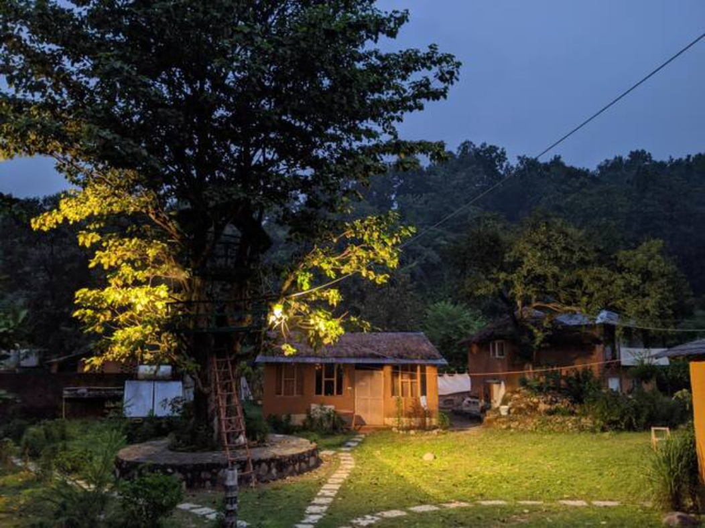
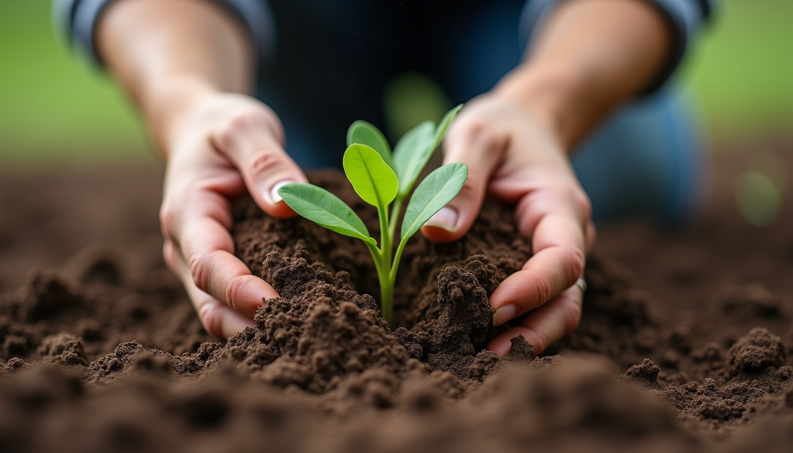

When I first heard about the Kaaya Fellowships, I was drawn by the promise of a unique experience - one that blends learning with nature, community, and slow living. These fellowships offer more than just a program; they open a door to a world where the earth beneath your feet and the sky above become your classroom. Today, I want to share what I’ve discovered about these fellowships and why they might just be the perfect invitation for youth seeking nature-based experiences.

## What Are Kaaya Fellowships?

Kaaya Fellowships are immersive programs designed to connect people deeply with nature and traditional ways of learning. It is an invitation to live in a raw format, physically getting a pause from the fast pace of modern life. These fellowships encourage participants to slow down, observe, and begin to engage with environment around them.

Such kind of living is not easy, one can't consume serene, natural settings forever. Soon, the setting start demanding engagement and begin to teach how to live in harmony with nature, pushes to learn through hands-on activities, listening to tales and becoming a part of the community till one begin to understand the rhythms of the nature, the cycles of seasons, and the wisdom embedded in traditional practices.

## Why Choose Kaaya Fellowships?

Choosing to be part of Kaaya Fellowship means embracing a lifestyle that values simplicity and connection. It’s a chance to step away from screens and schedules and step into a world where every moment is an opportunity to learn and grow.

Here are some reasons why these fellowships stand out:

- **Nature as a Teacher**: The natural world becomes the primary guide. From observing plants and animals to understanding soil and water, learning is rooted in the environment.
- **Community Living**: Participants live and work together, fostering bonds and shared experiences that enrich the journey.
- **Sustainable Practices**: The fellowships emphasize eco-friendly living, teaching skills like organic farming, composting, and natural building.
- **Creative Expression**: Art, music, and storytelling are woven into the daily rhythm, allowing participants to express themselves and connect emotionally.
- **Mindful Presence**: There is a gentle encouragement to be present, to listen deeply, and to appreciate the small wonders around us.

These elements combine to create a nurturing space where families and groups can reconnect with each other and the earth.

## How Kaaya Fellowships Work

The structure of these fellowships is thoughtfully designed to balance learning, rest, and community engagement. Typically, a fellowship lasts from a few weeks to several months, depending on the program.

### Daily Life and Activities

- **Morning Rituals**: The day often begins with simple practices like yoga, meditation, or nature walks.
- **Workshops and Learning Sessions**: These cover topics such as traditional farming, herbal medicine, natural crafts, and environmental conservation.
- **Hands-On Projects**: Participants might build mud structures, tend to gardens, or create art from natural materials.
- **Community Meals**: Sharing food prepared from local, organic ingredients strengthens the sense of togetherness.
- **Evening Gatherings**: Storytelling, music, and reflection sessions help close the day with warmth and connection.

### Who Can Join?

These fellowships welcome a diverse group of people - from curious children to enthusiastic youth, from families seeking meaningful vacations to groups wanting to bond over shared experiences. The programs are designed to be inclusive and adaptable, ensuring everyone finds their place.

## The Impact of Fellowships on Participants

Having spent time in such a fellowship, I can say the impact is profound and lasting. Participants often describe a renewed sense of calm and clarity. The experience nurtures patience, creativity, and a deeper respect for the environment.

For youth, it’s a chance to learn outside the classroom, developing skills that textbooks cannot teach. They gain confidence, teamwork abilities, and a sense of responsibility towards nature.

## How to Get Involved with Kaaya Fellowships

If you feel the call to explore these enriching experiences, here are some practical steps to get started:

1. **Reach Out**: Contact the organizers to ask questions and understand the fellowship’s structure, costs, and expectations.
2. **Prepare Mindfully**: Pack simple, comfortable clothing and be ready to embrace a lifestyle that values minimalism and nature.
3. **Set Intentions**: Think about what you hope to gain from the experience - whether it’s learning new skills, finding peace, or building community.
4. **Engage Fully**: Once there, immerse yourself in the activities, listen deeply, and allow yourself to be transformed by the journey.

For those interested, you can explore more about Kaaya Fellowship to find programs that resonate with your spirit.  **Apply to** [**ongoing**](/journal/aritram/) **fellowship opportunity**

[Apply Now →](/journal/aritram/)
